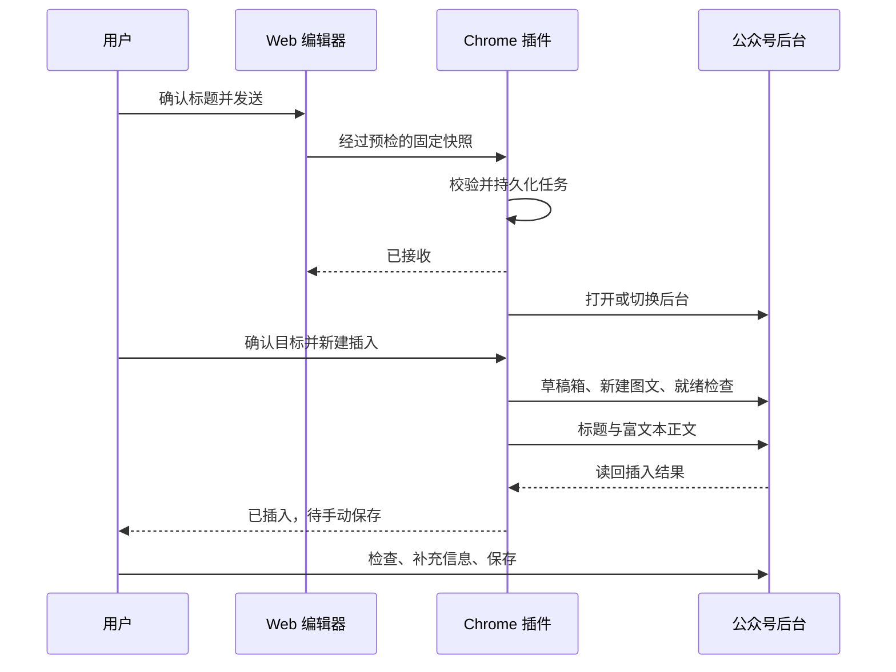

# Web 与 Chrome 轻量传稿插件

## 授权、目标与当前事实

维护者确认官方 HTTP 草稿 API 路线无法使用，选择 Web 加轻量 Chrome 插件；本轮仅编写设计与实施计划。第一版自动进入草稿箱、新建图文并插入文字排版，用户检查后手动保存。含图片的文章在传稿前阻断，明确提示使用既有复制流程，不删除图片后继续。长期边界见[ADR](../decisions/ADR-20261011-wechat-transfer-extension.md)，阶段出口见[实施计划](../plans/active/2026-10-11-wechat-transfer-extension.md)。

当前实现只有 `apps/frontend`：Vue、Pinia、Element Plus 桌面 Web 编辑器，GitHub Pages 静态托管，最小宽度 800px。workspace 拥有 localStorage 配置、IndexedDB current 和主动文章版本；wechat-export 的公开 `exportArticle` 生成受控、内联、清洗后的 HTML/纯文字，`copyRichText` 写入剪贴板。固定头尾进入导出，阅读外壳、临时诊断、装饰纯文字不进入文章正文。当前 ArticleDocument 无独立标题、作者、摘要或封面字段；当前图片导出转为 data URL，不能直接视为页面接口图片持久化能力。

下文除上述当前事实和明确引用的官方能力外，均为尚未实施的设计。不会把未来目录、权限、消息或公众号实测记作已经存在。

## 第一版范围

- 点击插件图标打开简洁操作面板，由“打开桀士排版”打开或切换 Web 标签页。
- Web 中显式“发送到公众号”生成不可变文章快照，插件确认接收后打开或切换公众号后台。
- 识别公众号后台并显示传稿按钮；用户点击后自动进入草稿箱、选择新的图文创作、填入标题和正文。
- 第一版内容包含现有文字排版、局部标注、章节装饰、列表、引用、代码块、表格及启用的固定头尾；这些内容必须经过逐项公众号验收。
- 第一版只创建新的图文编辑页面；不向已有非空文章追加或覆盖，不自动保存、发布、群发，也不调用私有 HTTP 草稿接口。
- 含正文图片、固定头尾图片或图片型排版素材的快照整篇阻断。保留现有复制入口，告知用户在公众号手动粘贴并检查图片。
- 不提供插件内完整编辑器、云同步、账户系统、素材上传、作者/摘要/封面管理或多篇队列。每个浏览器配置文件同一时刻只保留一个待传任务。

## 用户流程与界面

Web 顶栏在现有“复制到公众号”附近增加有语义图标和可见标签的“发送到公众号”，不改既有复制行为。未配置插件 ID、插件未安装、被禁用、权限未授予、协议不兼容均显示可理解的连接状态；超时只能显示“未连接”，不能确定断言“未安装”。编辑恢复中、页面冲突锁、输出准备中或传稿提交中禁用发送。

点击发送后展示紧凑的传稿确认面板：标题输入、正文统计、目标说明和“发送并打开公众号”。标题候选来自正文第一个一级标题的纯文字；没有一级标题时由用户填写。标题作为传稿任务字段，不新增 ArticleDocument 或 settings 存储字段，不删改 Markdown 首标题，不与预览外壳的模拟元信息混用。标题去首尾空白，非空且不超过 64 个 Unicode 码点；此值是插件保护值，公众号实际校验更严格时原样展示限制，用户在 Web 调整后重送。只有有效正文，不以空白或只有装饰创建任务。

发送前检查正文和启用头尾的图片语义；图片存在时不发任务、不打开后台、不创建文章，提示“这篇文章含图片，请使用‘复制到公众号’，在后台粘贴并检查图片”。采用 article/ending/assets 已登记的公共接口解析，wechat-export 提供公共预检结果；不得让 workspace 或传稿模块读取其他模块私有渲染器。使用独立文字传稿导出入口复用文章 DOM、排版、头尾、链接转换和清洗，不先调用会抓取/转换图片的剪贴板图片流程。文字传稿结果使用独立候选 profile，既有剪贴板 profile 保持原语义。

插件面板只显示“打开桀士排版”“打开公众号”、待传标题/时间/状态、“新建并插入”和“取消待传”，不承载写作与排版。公众号页面中的小型浮动面板提供同样的任务摘要和操作，使用 Shadow DOM 或等价局部隔离，不改变公众号原有布局；关闭只隐藏面板，不取消任务。按钮具备键盘操作、可见标签、focus 状态及执行中的禁用反馈。

成功插入后显示“已插入，请检查排版并手动保存”。这里不显示“已保存草稿”或“已发布”。任务接收成功只显示“插件已接收”，公众号页面实际插入验证通过才显示“已插入”。

## 职责、目录与依赖边界

未来目录仅为实施规划，本轮不创建代码、workspace、依赖或模块登记。

| 位置/模块                                                       | 职责和规划公共文件                                                                                                                  | 允许依赖                                            |
| --------------------------------------------------------------- | ----------------------------------------------------------------------------------------------------------------------------------- | --------------------------------------------------- |
| `apps/frontend/src/modules/workspace`                           | 复用保存/冲突锁；组装输出和传稿 UI，调用公开服务                                                                                    | 现有依赖加 Web wechat-transfer                      |
| `apps/frontend/src/modules/wechat-export`                       | 公共图片预检、文字传稿输出；复用现有排版清洗，保持剪贴板能力                                                                        | article、typesetting、ending、assets                |
| `apps/frontend/src/modules/wechat-transfer`                     | Web 握手、消息提交/状态、发送面板；公共 `wechat-transfer.service.ts`、`wechat-transfer.model.ts`、`wechat-transfer-panel.vue`       | 共享 wechat-transfer 协议包；不导入 workspace/store |
| `apps/extension/src/modules/wechat-transfer`                    | 单任务校验、仓储、状态机、去重和执行协调；公共 `wechat-transfer.service.ts`、`wechat-transfer.model.ts`                             | 共享协议、wechat-page                               |
| `apps/extension/src/modules/wechat-page`                        | 页面探测、账号/标签绑定、草稿箱新建导航、官方 JSAPI 桥接、标题写入及正文读回；公共 `wechat-page.service.ts`、`wechat-page.model.ts` | 共享协议；不访问任务仓储                            |
| `apps/extension/src/modules/extension-shell`                    | 插件面板和公众号浮层呈现、操作事件；公共 `extension-shell.service.ts`                                                               | wechat-transfer、共享协议                           |
| `packages/wechat-transfer-contract/src/modules/wechat-transfer` | Zod 运行时 Schema、错误码和版本；通过显式包 exports 公开 `wechat-transfer.schema.ts`                                                | Zod；不依赖任一应用                                 |

扩展根下的 service worker、popup 和 content script 入口只注册/组装模块。公众号 content script 在 ISOLATED 世界呈现浮层和发送操作；内置 MAIN 桥接文件仅调用允许的官方编辑器接口，输入 Schema 校验后才执行，返回经过筛选的值，不持有任务仓储或 chrome.runtime。所有脚本随插件打包，不能从线上下载后执行。

跨层对应业务名统一为 wechat-transfer。Web→workspace→wechat-export / wechat-transfer；扩展 extension-shell→wechat-transfer→wechat-page，协议包是叶子依赖，不产生循环。实施时先建立共享 Schema，再更新两端；同步 `.module-boundaries.json`、模块设计、pnpm workspace、TypeScript、ESLint 和构建检查器的必要入口登记。包 exports 逐文件明确登记，不导入 Web 私有 store、仓储、渲染组件或样式；不以新别名、入口白名单或整包 barrel 绕过边界。

## Web 与插件通信

采用 `externally_connectable` 加 `chrome.runtime.sendMessage`；Web 明确配置稳定的扩展 ID。生产 ID 和开发 ID由实际插件包/开发 key 确定，实施前记录，不在设计里虚构。Web 构建配置缺失 ID 时保持手动复制可用，连接插件入口显示配置未完成。开发 ID 对应的 manifest key 只可使用公开 key，私钥不进入仓库。

生产允许来源为 `https://tanghaojie.github.io/JLabWeChatEditor/`。Chrome manifest 的来源匹配不能作为项目路径隔离的唯一依据：接收端再次检查真实 `sender.url` 的协议、主机、端口、路径及顶层 frame，不接受 payload 自报来源。只允许该项目根和其静态入口，不允许同一 GitHub origin 下其他项目；协议不支持任意 URL、脚本、选择器或编辑器方法名称。开发构建单独允许实际 `http://127.0.0.1:5175/` 和预览 `4175`，生产包不带 localhost 权限。

消息、字段、尺寸和错误码以[协议规格](../reference/wechat-transfer-protocol.md)为唯一设计来源；实施后对应 Zod Schema 为结构来源，类型使用 `z.infer`。两端均校验，对未知字段、版本、来源、损坏数据和未支持动作拒绝；HTML还要复用受控清洗并在插件接收时防御性清洗。禁止在错误回显中附原始 HTML、正文、请求 URL 查询参数、账号标识或登录凭据。

Web 的 `SUBMIT_TASK` 只接收/持久化；`OPEN_WECHAT` 只打开固定允许后台入口，不能直接触发插入。新建和写入必须来自插件面板/公众号浮层的显式用户操作，并确认实际目标账号。扩展应答或由 Web 建立的查询得到状态；不假定扩展能直接向普通网页主动发送消息。Web 在页面恢复可见、用户操作或当前传稿短期等待期间查询状态，禁止永久高频轮询。

发送准备捕获整个输出输入的 generation；正文、标注、配色、章节、文字设置、启用头尾等任何输出相关变化均使准备失效，不能只比较 article.revision。准备过程中更新/恢复/冲突时拒绝迟到结果。插件确认接收后快照不随 Web 继续编辑自动变化，界面明确时间与标题；重送需要显式替换尚未执行的任务。

## Chrome 版本、权限与运行环境

采用 Manifest V3，设计最低 Chrome 120；最终最低版本在 P0 能力验证后确认。第一版针对 Chrome 桌面，Edge 等其他 Chromium 浏览器单独验收后再宣布支持；不声明手机、无痕或跨浏览器配置文件支持。

| 权限/声明                                          | 用途与边界                                                 |
| -------------------------------------------------- | ---------------------------------------------------------- |
| `storage`                                          | 插件任务和轻量回执；禁止 cloud sync                        |
| `scripting`                                        | 将内置桥接代码执行于已授权公众号页面 MAIN 世界             |
| `host_permissions: https://mp.weixin.qq.com/*`     | 查询目标标签、注入、运行网页流程                           |
| `host_permissions: https://tanghaojie.github.io/*` | 查找并切换已有 Web 标签；仅实际项目路径可接受/打开         |
| `content_scripts` 仅匹配公众号后台                 | 注入操作浮层、页面变更观察；不向普通文章阅读页提供写入按钮 |
| `externally_connectable`                           | 允许 Web 握手/传稿，额外运行时校验项目路径                 |

不申请 `<all_urls>`、全局 tabs、cookies、debugger、clipboardRead/Write、downloads 或 nativeMessaging 权限。若能力验证发现必须增加权限，记录真实原因并更新设计，而非预先申请。host 权限已经覆盖对应标签的查询；content_scripts 只声明必要匹配，不做全站扫描。扩展 action 的 popup 只承载操作，不在离开即关闭的 popup 中保存写作状态。

MV3 worker 会休眠，后台采用事件驱动，任务写入存储后才应答。不能靠全局内存、一直打开 popup 或人为保活完成跨页面任务。记录更新仅由 worker 的 wechat-transfer 仓储服务串行写入；浮层和 popup 通过消息调用，不直接写存储。将 storage.local 的 content-script 访问级别设为 TRUSTED_CONTEXTS。

## 任务、快照与生命周期

Web 原文章、配置、素材和版本留在原 origin；插件只复制最终 HTML、纯文字、临时标题与必要来源版本摘要。传稿不改变 current、writeId、主动历史或多页面冲突规则，不读取 Web IndexedDB 私有表。

每个 Chrome 配置文件只有一个任务：其 Schema 覆盖 taskId、source generation/文章 revision、payload digest、创建/失效时间、phase、attemptId、绑定标签/文档/账号和错误分类。HTML、纯文字、标题和信封合计 UTF-8 序列化上限 2 MiB，TTL 为 24小时；这是插件资源保护值，不是微信 HTTP API 限制。不申请 unlimitedStorage。读写失败或配额不足时拒绝接收，不覆盖既有有效任务。损坏/未知格式不自动覆写，显示任务不可恢复并允许用户显式清除。

接收成功、开始新建、开始写入前均先持久化状态，等待持久化完成再执行网页副作用。相同 requestId 和 digest 重试返回相同任务/回执；相同 requestId 不同内容拒绝；不同任务替换待传快照必须由用户明确确认，正在执行或结果不确定的任务不能静默替换。所有任务命令串行；每次执行使用唯一 attemptId、lease 和预期 phase，迟到页面响应不能推进新任务。

在同一个版本化存储记录中保存当前任务和最多100个24小时内的request回执，回执只含requestId/digest/taskId、终态和时间，不保留正文。取消、替换、插入都保留短期去重回执，防止迟到的SUBMIT重试重新激活旧稿；回执到达上限时拒绝新增任务，不静默驱逐未过期回执。单写入者一次替换完整记录，读取失败/写入失败不得先清除旧任务。记录仍受Chrome实际配额约束。

| phase                              | 进入条件、操作与恢复                                             |
| ---------------------------------- | ---------------------------------------------------------------- |
| `pending`                          | 校验并存储成功；可打开后台、取消或显式替换                       |
| `waiting_login` / `waiting_target` | 未登录或多个目标；保留任务，等待用户登录/选账号并再点击继续      |
| `creating`                         | 目标确认、执行租约和本次导航标记已存储；进入草稿箱、新建图文     |
| `waiting_editor`                   | 只接受绑定标签/本次新建文档；等待页面 API 和空编辑器             |
| `applying`                         | 校验账号/文档/空正文与标题，记录即将写入；写标题和正文           |
| `inserted`                         | 官方正文读回及标题确认完成；显示手动保存，禁止自动重发           |
| `blocked`                          | 已知未写入的前置失败；解决后可显式继续安全步骤                   |
| `uncertain`                        | 新建/写入后超时、页面关闭、worker 重启或读回不匹配；不得自动重放 |
| `cancelled` / `expired`            | 仅在未执行时允许取消；清除载荷，不能撤回公众号已有修改           |

worker 重启时，pending 可继续；creating、waiting_editor、applying 只允许重新探测绑定页面，不能假定副作用未发生。无法确定本次新建或插入结果时进入 uncertain，提示用户检查已打开页面。按钮不提供“一键重试全部”；只有证明未执行的步骤才能重试，结果不确定时由用户确认后明确新建另一个任务。用户在执行过程中切账号、导航、编辑内容或关闭标签页均停止操作；取消后不删除公众号已创建页面。

inserted 后立即删除 HTML 和纯文字，只留 taskId/digest、标题、插入时间与必要状态回执用于去重，到期删除；未插入任务24小时到期清除载荷。到期检查发生于 worker 唤醒、启动/读取/新命令，不保证无事件时正点运行。标题也只在本地短期保存。浏览器重启不恢复旧 tabId/文档绑定，也不自动创建页面；保留 pending，执行中任务转 uncertain 后重新确认。查询失败不能当作“没有任务”，插件卸载清除本地任务不影响 Web 原稿。

## 公众号页面适配与插入

微信官方已公开 `window.__MP_Editor_JSAPI__`，包含 `mp_editor_get_isready`、`mp_editor_get_content`、`mp_editor_set_content` 和 `mp_editor_insert_html`。官方正文接口要求 get_isready 返回 isNew=true。本设计选择对本次新建的空编辑器使用 set_content 设置整篇正文；不通过模拟 Ctrl+V、合成 paste 或 contenteditable.innerHTML 修改来冒充编辑器状态。

P0 必须人工验证实际账号、编辑器页面、JSAPI 对象和 invoke 的回调形态、返回字段及可用文档/frame；本轮没有现场验证。MAIN 桥接只包含固定允许操作；ISOLATED 浮层不直接读取公众号页面全局变量。优先绑定检测到官方 API 的文档，未知或跨域 iframe 不盲目执行，不能以全 frame 写入作为兜底。

草稿箱→新的创作→图文导航没有由所引用 JSAPI 提供公开接口。wechat-page 维护独立页面适配器，用真实页面的语义标签/可访问名称、观察到的入口和官方页面路径定位；不在设计中虚构 URL、CSS 选择器或 token，不冻结登录 query 参数。不直接 fetch 公众号私有保存/发布接口。只在明确识别的后台首页/草稿列表状态执行导航；若当前正在编辑非空内容，则新开独立后台标签，不离开或覆盖原页面。若入口唯一性/目标文档无法证明则阻断。

单一后台标签仍要向用户展示当前账号并确认；多个候选标签由用户选择，不能选第一个，也不能按最近打开自动写入。执行前与写入前分别核对账号、登录态、tab/document 和编辑器状态。若显示账号/稳定身份信息无法可靠确定，进入 waiting_target，不跨账号自动继续。账号只在本地本次任务绑定，不导出、上传或写入诊断日志。

新建流程记录本次导航标记和开始时间，复用空编辑器必须是本次操作确实创建/绑定的文档，不能因为其他标签恰好为空就写入。导航与编辑器就绪各设计30秒超时，JSAPI 单次调用10秒；登录/选账号不受这些短超时约束，但仍受任务TTL限制。采用页面 ready/DOM 变更与有截止时间的探测，不用固定 sleep 假定页面已完成；页面未知时阻断。MAIN桥接在实际写入前再次验证预期文档、编辑器空状态与本次执行令牌；预检和异步调用之间若检测到用户输入则停止，无法排除写入时序竞争时按uncertain处理，不宣称这几个页面动作具有原子性。

标题通过页面当前有效输入控件和真实输入事件适配，填入后确认显示值；P0 验证该方式是否进入公众号内部文章状态，不能把 DOM 赋值当作标题保存成功。正文调用官方 set_content，检查返回并调用 get_content 读回。微信可能整理 HTML，读回不能只做字节完全相等比较：对规范化后的可见文字、段落/标题顺序、头尾、关键内容及无图片进行完整性检查；具体读回结构和容差由 P0 真实结果确定，无法确认则进入 uncertain，不重插。

读回证明的是编辑器已接收；排版保真、保存后重开、撤销与继续编辑仍由人类验收。插件不填写作者/摘要/封面，不点保存；用户在后台补齐需要的信息并手动保存。公众号自身是否自动保存属于平台行为，P0记录实际表现，插件不关闭或承诺阻止平台自动保存。官方接口缺失、isNew不支持或正文读回失败时，保持原稿和任务摘要，提示使用现有复制流程，不降级为读取私有编辑器全局实例或自动模拟粘贴。

## 构建、分发与兼容

Web 的现有 Pages 发布路径和静态产物不变。未来 `apps/extension` 独立构建 MV3 worker/content/MAIN桥接/popup 和本地静态资源；初次交付为可加载的 unpacked 目录与 ZIP、明确版本/扩展 ID/安装指南。插件代码、图标和清洗依赖随包发布，第一版不嵌远程 Web iframe、不引入后端或远程代码热更新。

自动化实现获得新授权后才新增依赖、锁文件和构建入口；只引入现实需要的 Chrome 类型、Schema/清洗与构建工具，审查实际包许可和 CSP，不自动安装辅助工具。现有根 build/检查必须能验证两个应用和协议边界；扩展包不能混入 Web 源码、开发 origins、私钥、source-map 私有资料或待传文章。

Web 与扩展独立发布，握手协商协议版本和文字传稿 capability。遇到不兼容明确提示更新/使用复制，不能通过猜字段执行。扩展的 UI/适配器更新必须随版本发布；Chrome Web Store 上架、账号付费、商店审核和远端发布不是本轮设计交付，也不是首次本地实现默认授权。

## 验证策略、风险与未实施事项

本轮只运行文档结构/链接、格式、diff 与归档检查；不运行前端自动化或修改产品代码。未来代码阶段执行格式、Lint、类型、生产构建、模块边界、文档和归档CI；涉及治理检查器和纯共享 Schema 契约的检查按适用策略执行，不创建或运行前端单元、组件、E2E或浏览器自动化，除非维护者另行明确授权。

人工验收必须覆盖：安装/连接/权限与不兼容、来源路径拒绝、当前多标签冲突锁、输出变化竞态、文字排版/头尾/标题、含图片阻断、任务替换/去重/配额、worker休眠与浏览器重启、登录/多个公众号选择、已编辑内容保护、导航超时/页面改版、JSAPI缺失/isNew不支持、插入回执丢失、用户中途编辑、手动保存并重开、手机/电脑明暗阅读。不得用静态检查或官方文档存在宣称这些已通过。

主要风险是公众号导航入口及标题控件变化、JSAPI在实际账号上的可用性、HTML整理影响排版、发送后快照与继续编辑的差异、以及插入副作用与本地回执之间无法原子提交。通过P0能力验证、公开接口优先、来源和目标绑定、不可变快照、预写状态、uncertain不自动重放与人工验收处理；不承诺页面自动化永远兼容。

首版明确排除含图片传稿，但没有删掉 Web 现有图片或复制能力。后续图片、自动保存、插件内编辑器、其他浏览器或账号云能力必须另行设计/授权。细节见[协议](../reference/wechat-transfer-protocol.md)、[来源与证据](../reference/wechat-transfer-research.md)和[实施计划](../plans/active/2026-10-11-wechat-transfer-extension.md)。
